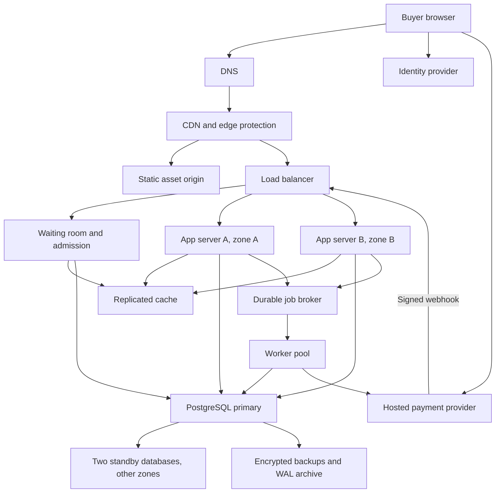

# TicketHub: Event Ticketing System Design

Status: complete design proposal for the assignment. Capacity and recovery
figures are acceptance targets, not measured results. No TicketHub service
has been implemented, deployed, or load-tested.

## 1. Context

TicketHub sells reserved seats for concerts and events to two million
registered users. Its main challenge is a sale where 200,000 people compete
for 20,000 seats in ten minutes, while bookings remain correct and admission
remains fair.

## 2. Goals and non-goals

Buyers browse events/seats, temporarily hold available seats, confirm their
selection and price, pay, and view their tickets. Orders support up to four
seats from one event. Partial holds preserve available seats while the buyer
chooses replacements. Each account may have at most four confirmed-plus-held
seats for an event across all orders; expired/cancelled holds free allowances.

Resale, auctions, dynamic pricing, general-admission inventory, organiser
editing tools, and customer cancellation/refund products are outside scope.
Technical voids/refunds for failed or late payments remain necessary. A trusted
administrative process prepares events, prices, and seat maps before sale.

## 3. Requirements and estimates

### Functional requirements

- Browse events and inspect event-specific seat availability.
- Authenticate buyers and restrict orders/tickets to their owners.
- Hold available requested seats, report conflicts, allow additions/removals,
  and show the original expiry, current price, and remaining account allowance.
- Require explicit confirmation of the final seats/price before payment.
- Verify payment and durably confirm bookings before issuing tickets; release
  abandoned holds and resolve late/duplicate payment notifications safely.
- Admit popular-sale buyers through a waiting room; let owners view orders/tickets.

### Non-functional requirements

These are proposed acceptance targets requiring tests.

| Concern        | Requirement                                                                                                                                                                                                               |
| -------------- | ------------------------------------------------------------------------------------------------------------------------------------------------------------------------------------------------------------------------- |
| Speed          | Browsing API p95 at most 300 ms; admitted seat-hold API p95 at most 1 second. p95 means 95% finish within the target. Measure queue delay/provider payment time separately.                                               |
| Correctness    | Zero duplicate valid bookings for the same event seat, including retries, concurrency, expiry, and delayed payment notifications.                                                                                         |
| Fairness       | First-in, first-out admission by server-issued sequence; refresh preserves position. One active queue entry/hold and at most four confirmed-plus-held seats per account/event. Account limits do not prove unique people. |
| Hold duration  | Five minutes from the first successful hold, using database time. Adding seats, refreshing, and paying do not extend it. Expired orders cannot receive tickets.                                                           |
| Retry safety   | Repeating an operation cannot create another hold/charge; repeated notifications cannot issue more tickets.                                                                                                               |
| Availability   | Target 99.9% monthly availability: about 43.2 minutes unavailable in a 30-day month. No planned maintenance during advertised sales.                                                                                      |
| Recovery       | Preserve acknowledged bookings through one database-node/zone failure; target automatic recovery within 60 seconds.                                                                                                       |
| Security       | HTTPS, verified identities, ownership checks, signed admission, abuse limits, and hosted payment collection; store provider references rather than raw card details.                                                      |
| Burst capacity | Initial targets: 1,000 waiting-room arrivals/second and 10,000 public page views/second including cached pages. Bound checkout admission by measured database capacity.                                                   |

### Workload and calculations

Given: 2,000,000 accounts; 50,000 daily visitors viewing ten pages each;
5,000 tickets sold normally; 200,000 buyers pursuing 20,000 seats in ten minutes.
Registered accounts are not simultaneous users. Daily visitors equal 2.5% of
accounts. Use 86,400 seconds/day and 600 seconds/sale window.

| Measure                                       | Arithmetic                                  | Rate            |
| --------------------------------------------- | ------------------------------------------- | --------------- |
| Normal page views                             | 50,000 × 10 = 500,000/day; divide by 86,400 | 5.79/second     |
| Normal visitor arrivals                       | 50,000 / 86,400                             | 0.58/second     |
| Normal ticket sales                           | 5,000 / 86,400                              | 0.0579/second   |
| Sale-window buyer arrivals                    | 200,000 / 600                               | 333.33/second   |
| Ticket sales if all seats sell in ten minutes | 20,000 / 600                                | 33.33/second    |
| Assumed sale page views: ten per visitor      | 200,000 × 10 / 600                          | 3,333.33/second |

The sale ticket rate is `(20,000 / 600) / (5,000 / 86,400) = 576` times the
normal-day average. The assumed page-view rate is also 576 times its normal
average. Ten views per sale visitor is an additional assumption, not a given
sale fact. There are ten competing people per seat; at most 10% can obtain a
seat if each successful buyer takes one.

With one to four seats/order, a sellout means 5,000–20,000 paid orders, or
8.33–33.33 paid orders/second over ten minutes. Failed attempts and abandoned
holds generate work too. Page views, API calls, orders, and tickets are
separate units; polling, assets, retries, and payment notices need additional
request budgets in the architecture.

These are averages over the specified windows, not instantaneous peaks.
Assuming a provisional 3× short burst gives `333.33... × 3 = 1,000` arrivals
and `3,333.33... × 3 = 10,000` public page views/second. Test concentrated
launch-time arrivals too: 3× is not a worst-case bound. Offered demand enters
a waiting room; the booking database sees controlled admitted traffic.

## 4. Proposed design

### 4.1 API conventions

Use HTTPS/JSON, UTC timestamps, server-generated positive integer IDs, and
integer money in currency minor units. Seat labels such as A1 are event-scoped.
Prices come from the server; examples use USD cents with no additional fees.
Public event/seat browsing may be cached briefly; availability is advisory.
Private responses use `Cache-Control: private, no-store`.

Queue/order/payment/ticket routes require a verified bearer access token;
server-side identity determines the owner. Other-owned resources return `404`.
During a popular sale, a signed account/event admission token permits initial
hold creation; an existing valid order retains editing permission until expiry.
Lists use opaque cursor pagination, `limit` 1–100 (default 50), and an envelope
such as `{ "data": [], "next_cursor": null }`. Seats can be filtered by section.

Buyer POST requests require an `Idempotency-Key`, identifying one logical
operation across retries. Authentication, validation, ownership, and quota
checks still apply. One active `HOLDING`/`PAYMENT_PENDING` order is allowed per
account/event; another create attempt returns `409` with the existing owned
order ID. Excess confirmed-plus-requested seats return `409 purchase_limit_exceeded`.

### 4.2 Endpoints

| Method | Path                                 | Purpose                                                   | Success               |
| ------ | ------------------------------------ | --------------------------------------------------------- | --------------------- |
| GET    | `/events`                            | Browse events.                                            | 200                   |
| GET    | `/events/{event_id}`                 | Read event details.                                       | 200                   |
| GET    | `/events/{event_id}/seats`           | Read seats and indicative availability.                   | 200                   |
| POST   | `/events/{event_id}/queue-entries`   | Join/reuse an owned active queue entry.                   | 201 new; 200 existing |
| GET    | `/queue-entries/{entry_id}`          | Read owned position/admission token and polling interval. | 200                   |
| POST   | `/orders`                            | Hold the available requested seats in a new order.        | 201 if any held       |
| GET    | `/orders/{order_id}`                 | Read owned selection, version, expiry, and payment state. | 200                   |
| POST   | `/orders/{order_id}/seats`           | Add available seats to an editable hold.                  | 200                   |
| DELETE | `/orders/{order_id}/seats/{seat_id}` | Release one seat and return the updated order.            | 200                   |
| DELETE | `/orders/{order_id}/hold`            | Cancel the hold, release seats, preserve history.         | 204                   |
| POST   | `/orders/{order_id}/payments`        | Confirm selection/price and start/resume payment.         | 202                   |
| GET    | `/me/tickets`                        | List the owner's valid confirmed tickets.                 | 200                   |
| POST   | `/payment-webhooks`                  | Durably accept a signed provider notification.            | 200                   |

`201` includes `Location`; `204` has no body. Webhooks use provider signatures,
not buyer tokens. Polling clients respect supplied intervals and add jitter.

### 4.3 Partial holds

With bearer authentication, sale admission, JSON content type, and
`Idempotency-Key: hold-example-01`, send `POST /orders`:

```json
{
  "event_id": 101,
  "seat_ids": [601, 602, 603]
}
```

The buyer has no earlier tickets for this event. A1/A2 are available; A3 is
occupied. After committing the partial hold at 17:00 UTC, return `201` with
`Location: /orders/9001`:

```json
{
  "order_id": 9001,
  "event_id": 101,
  "status": "HOLDING",
  "version": 1,
  "outcome": "partial",
  "held_seats": [
    { "seat_id": 601, "label": "A1", "unit_price_minor": 7500 },
    { "seat_id": 602, "label": "A2", "unit_price_minor": 7500 }
  ],
  "unavailable_seats": [
    { "seat_id": 603, "label": "A3", "reason": "unavailable" }
  ],
  "currency": "USD",
  "total_minor": 15000,
  "remaining_allowance": 2,
  "expires_at": "2026-10-18T17:05:00Z"
}
```

Offer a replacement, explicit purchase of the two held seats, or cancellation.
`outcome`/`unavailable_seats` describe the request; held seats, total, version,
allowance, and expiry describe the order. To add A4, use a new key and send
`POST /orders/9001/seats`:

```json
{
  "seat_ids": [604]
}
```

If available, the new total is 22500, version 2, remaining allowance 1, and
expiry still 17:05. If unavailable, return `409` and preserve A1/A2.

Validate all IDs/event membership before allocation. Requests contain one to
four distinct IDs. Hold every available requested seat: initial results are
full/partial, or `409` with no order if none are available. Additions preserve
existing seats; already-held IDs are harmless. Reject requests whose confirmed
seats plus existing/requested union exceed four; do not silently trim for quota.
Only explicit removal/cancellation or expiry releases held seats. Removing the
last seat cancels the hold; completed removals/cancellations are repeatable.
Hold changes increment version. Only `HOLDING` is editable; incompatible states
return `409`, expired mutations `410`. GET returns the current order state.

### 4.4 Payment and expiry

After the buyer confirms A1/A2/A4 and their price, send
`POST /orders/9001/payments` with a new operation key:

```json
{
  "order_version": 2,
  "confirmed_total_minor": 22500,
  "currency": "USD"
}
```

1. Verify owner, deadline, all allocations, version, and server-derived total.
   Atomically store a frozen payment operation and mark the order `PAYMENT_PENDING`.
2. After commit, return `202` with `Location: /orders/9001`. A worker creates
   hosted checkout outside database transactions using the operation's stable
   provider key. GET exposes `checkout_url` when ready; clients poll with backoff.
3. Timeouts leave an unknown outcome. Reconcile that operation instead of
   creating another charge. Retries refer to the frozen selection/operation.
4. Verify webhook signatures against the raw body with provider libraries;
   durably store event IDs before acknowledgement. Check payment reference,
   amount, currency, and order. Browser redirects do not confirm payment.
5. For an eligible order, atomically confirm every frozen seat and mark `PAID`,
   then expose one ticket per seat. An expired/missing allocation means no
   tickets and durable full void/refund work, never a silently reduced purchase.

The five-minute deadline applies during payment. Expiry releases seats; late
payment success cannot reclaim them. Persist `REFUND_PENDING`, retry the full
void/refund with a stable key, and mark `REFUNDED` on confirmation. This can
require refunding a charge made just before expiry if confirmation arrives
late. Explain the deadline clearly; unknown outcomes require reconciliation.

```text
HOLDING -> PAYMENT_PENDING -> PAID
HOLDING -> CANCELLED or EXPIRED
PAYMENT_PENDING -> EXPIRED, or CANCELLED after confirmed terminal failure
EXPIRED or CANCELLED -> REFUND_PENDING -> REFUNDED (late successful charge)
```

Editing/cancellation is allowed only in HOLDING. An expired/terminally failed
order requires a new admitted hold. A card retry within the existing hosted
flow can continue before expiry without a new TicketHub payment operation.

### 4.5 Retries and errors

Store retry receipts for at least 24 hours, keyed by user/method/path/key.
Same key/body returns the saved result; different input returns `409`.
Concurrent in-progress retries receive `409 operation_in_progress` and
`Retry-After`. Accepted payment operations use `202` and the owned order URL.
Replay is a historical receipt: it never renews/recreates an expired hold;
GET returns current state. Save executed availability conflicts too; new
selection attempts use new keys. Payment references survive for the order's
lifetime, so expired retry receipts cannot authorize another uncertain charge.

| Status    | Meaning                                                                                                                                    |
| --------- | ------------------------------------------------------------------------------------------------------------------------------------------ |
| 400       | Invalid types/IDs, duplicate IDs, wrong event, or more than four requested seats.                                                          |
| 401 / 403 | Invalid authentication / forbidden or missing sale admission.                                                                              |
| 404       | Missing resource or another owner's order/queue entry.                                                                                     |
| 409       | Availability, purchase limit, stale selection, key reuse/in-progress operation, or incompatible state.                                     |
| 410       | Hold expired; inspect the order and obtain a new admitted hold if desired.                                                                 |
| 429       | Rate limit; respect `Retry-After`.                                                                                                         |
| 500 / 503 | Unexpected error / temporary unavailability; expose no internals. An already-started uncertain payment remains pending for reconciliation. |

Errors use `{ "error": { "code": "seats_unavailable", "message": "No requested seats are available.", "request_id": "example-request-id" } }`.
Conflicts can include unavailable seat IDs, never another buyer's identity.
Structural/authentication failures create no partial allocation.

### 4.6 Data model

Use PostgreSQL 18. A primary key (PK) identifies one row; a foreign key (FK)
references a related row. All business fields below are NOT NULL, including
allocation keys and statuses. IDs are generated BIGINT values, timestamps are
TIMESTAMPTZ, and money uses integer minor units. Optional provider fields are
identified separately. This is a schema design, not a complete migration.

| Business table | Columns and keys                                                                                                                                                                                                                                                                                                                                  |
| -------------- | ------------------------------------------------------------------------------------------------------------------------------------------------------------------------------------------------------------------------------------------------------------------------------------------------------------------------------------------------- |
| `users`        | `id BIGINT PK`, `auth_subject TEXT UNIQUE`, `email TEXT`, `created_at TIMESTAMPTZ`. One configured identity provider supplies the verified subject; no passwords are stored here.                                                                                                                                                                 |
| `events`       | `id BIGINT PK`, `title TEXT`, `venue TEXT`, `starts_at TIMESTAMPTZ`, `sale_starts_at TIMESTAMPTZ`, `currency CHAR(3)`, `status TEXT`. Add `UNIQUE(id, currency)` for the order currency reference.                                                                                                                                                |
| `seats`        | `id BIGINT PK`, `event_id BIGINT FK events(id)`, `section TEXT`, `label TEXT`, `price_minor BIGINT CHECK > 0`. Add `UNIQUE(event_id, label)` and `UNIQUE(id, event_id)`. Each row represents one seat at one event.                                                                                                                               |
| `orders`       | `id BIGINT PK`, `user_id BIGINT FK users(id)`, `event_id BIGINT FK events(id)`, `status TEXT`, `version INTEGER CHECK > 0`, `total_minor BIGINT CHECK >= 0`, `currency CHAR(3)`, `created_at TIMESTAMPTZ`, `expires_at TIMESTAMPTZ`. Status uses the states in section 4.4. The expiry is immutable and five minutes after the first hold starts. |
| `order_items`  | `id BIGINT PK`, `order_id BIGINT`, `user_id BIGINT`, `event_id BIGINT`, `seat_id BIGINT`, `account_slot SMALLINT`, `unit_price_minor BIGINT CHECK > 0`, `expires_at TIMESTAMPTZ`, `allocation_state TEXT`. State is `HELD`, `CONFIRMED`, or `RELEASED`. Add `UNIQUE(order_id, seat_id)`; prices are snapshots.                                    |

Required composite foreign keys keep the duplicated relationship fields valid:

- `orders(event_id, currency)` references `events(id, currency)`.
- `order_items(order_id, user_id, event_id, expires_at)` references
  `orders(id, user_id, event_id, expires_at)`; add that matching UNIQUE key on
  `orders`. An allocation therefore has its order's owner, event, and deadline.
- `order_items(seat_id, event_id)` references `seats(id, event_id)`, so an order
  cannot include a seat from another event.

Users and events each have many orders; events have many seats. An order has
many order_items, one per selected seat. A seat can appear in historical
released items, but only one active item. A confirmed item of a paid order is
one ticket; `/me/tickets` returns its item ID as `ticket_id`. No separate ticket
inventory is needed. Preserve booking history with restricted parent deletion.

Support records implement the retry, payment, and queue promises in the API:

| Table                | Important columns and constraints                                                                                                                                                                                                                                                                                                                      |
| -------------------- | ------------------------------------------------------------------------------------------------------------------------------------------------------------------------------------------------------------------------------------------------------------------------------------------------------------------------------------------------------ |
| `request_keys`       | PK `(user_id, method, path, key)`; user FK; method/path/key/hash TEXT; response status SMALLINT; response body JSONB; created/expiry TIMESTAMPTZ. Persist the operation result with its database changes.                                                                                                                                              |
| `payment_operations` | `id BIGINT PK`; `order_id BIGINT UNIQUE FK orders`; frozen selection/version/amount/currency JSONB; provider key TEXT UNIQUE; nullable provider payment/refund IDs TEXT UNIQUE and checkout URL TEXT; stable refund key TEXT UNIQUE; action/state TEXT; next retry and lease expiry TIMESTAMPTZ. One operation per order survives uncertain responses. |
| `payment_events`     | PK `(provider, event_id)` using TEXT; signed-event payload JSONB; nullable `operation_id BIGINT FK payment_operations`; processing state TEXT; retry/lease timestamps TIMESTAMPTZ. Record before acknowledging; unmatched receipts are reconciled before effects are applied.                                                                          |
| `queue_entries`      | `id BIGINT PK`; user/event FKs; `sequence BIGINT`; status TEXT; nullable admission expiry TIMESTAMPTZ and `order_id BIGINT FK orders`. UNIQUE `(event_id, sequence)` and one active entry per user/event across `WAITING`, `ADMITTED`, and `CONSUMED`; close a consumed entry when its order finishes.                                                 |

Section 4.10 defines queue sequencing and recovery. Payment workers
can rediscover pending work from durable operation/event records if a broker
notification is lost; the broker alone is not the record of a required refund.
Workers claim work with short, expiring leases and recover abandoned claims.
After the provider's key-retention window, reconcile existing provider objects
before retrying a side effect; keep unresolved work pending for investigation.

### 4.7 Constraints that protect seats and the four-ticket limit

Each account has four numbered purchase allowances for each event. The
`account_slot` field stores 1, 2, 3, or 4; it is unrelated to seat labels.
A held or confirmed item occupies one allowance. Released items free it.
These PostgreSQL examples apply to the schema above:

```sql
ALTER TABLE order_items
    ADD CONSTRAINT item_account_slot_range
        CHECK (account_slot BETWEEN 1 AND 4),
    ADD CONSTRAINT item_allocation_state
        CHECK (allocation_state IN ('HELD', 'CONFIRMED', 'RELEASED'));

CREATE UNIQUE INDEX one_active_allocation_per_seat
    ON order_items (event_id, seat_id)
    WHERE allocation_state IN ('HELD', 'CONFIRMED');

CREATE UNIQUE INDEX four_allowances_per_account_event
    ON order_items (user_id, event_id, account_slot)
    WHERE allocation_state IN ('HELD', 'CONFIRMED');

CREATE UNIQUE INDEX one_active_order_per_account_event
    ON orders (user_id, event_id)
    WHERE status IN ('HOLDING', 'PAYMENT_PENDING');

CREATE UNIQUE INDEX one_active_queue_entry_per_account_event
    ON queue_entries (user_id, event_id)
    WHERE status IN ('WAITING', 'ADMITTED', 'CONSUMED');
```

The first unique index prevents conflicting holds and confirmed bookings.
The allowance range plus its unique index permits at most four active items
per account/event across all orders. This avoids an unsafe cross-row COUNT
inside a CHECK constraint. The service assigns free allowance numbers and
rejects excess requests with `409 purchase_limit_exceeded`.

If an account owns two tickets, it may hold at most two more. Validate the
confirmed count plus the union of existing/requested held seats before adding
anything; do not silently select a smaller group just to fit the quota.
Cancelled and expired holds free allowances; paid tickets retain them.

Time passing does not update a partial index. Transactions must change
expired HELD items to RELEASED and expired orders to EXPIRED before reuse.
Never put a changing clock expression in these index predicates. A sweeper
handles expiry, and requests also reclaim expired allocations under locks,
so a delayed sweeper cannot leave seats unavailable indefinitely.

Useful read indexes include `seats(event_id, section, id)` for seat browsing
and `orders(user_id, created_at DESC, id DESC)` for owned order lookup/history.
Index support-table state/retry-time columns for workers. Indexes add write
and storage costs, so validate query plans against representative data.

### 4.8 Transactions and the double-booking guarantee

A transaction commits all its database changes together or rolls them back.
A row lock temporarily serializes competing changes to that row. The five-minute
hold is a persisted allocation, not a database lock held while someone pays.

Use short primary-database transactions at READ COMMITTED isolation. All
booking handlers, expiry workers, and payment processors follow the same order:
lock the affected buyer's users row, existing owned orders by ID, then all
required seats by ID, then change order_items. The user lock serializes that
account's requests; it does not lock every buyer. Include seats being released
from that account's expired hold as well as requested/current seats.

The seat-locking query uses bound parameters:

```sql
SELECT id
FROM seats
WHERE event_id = $1 AND id = ANY($2::bigint[])
ORDER BY id
FOR UPDATE;
```

Re-read allocations in a separate statement after obtaining the locks, so a
request that waited sees the preceding transaction's committed result. Read
`clock_timestamp()` after locks are acquired for deadline decisions: PostgreSQL's
`CURRENT_TIMESTAMP` is fixed at transaction start and could predate a lock wait.

For initial or additional holds:

1. Authenticate, verify admission, and obtain/validate the durable retry key.
   Lock the user and applicable existing order records. Resolve an expired
   owned order before creating a replacement; preserve any live active order.
   Queue joining also resolves the caller's expired order/consumed queue entry,
   so delayed background cleanup cannot block that account indefinitely.
2. Lock the required seat rows in ascending ID order. Re-read their allocations
   and deadline values. Release expired HELD items under those seat locks.
   Reclaiming another account's expired allocation changes only that item,
   never its former user's/order's rows; its expiry handler later reconciles
   the old order. Never release CONFIRMED items this way.
3. Check the account's remaining allowances and the request's four-seat bounds.
   Classify requested seats as already held by this order, available, or
   unavailable. An invalid request makes no new allocation.
4. Insert a new order only if at least one seat is available, or update the
   existing editable order. Write the available subset using free allowance
   numbers, snapshot prices, recompute the total, and increment the selection
   version when it changes. Re-adding a previously removed seat reactivates
   its RELEASED item instead of violating `UNIQUE(order_id, seat_id)` with a
   second row. Keep the original deadline on additions.
5. Store the retry result and commit before returning success. A business
   conflict can return a partial hold; a real database failure rolls back the
   transaction. If the response is lost after commit, retrying the same key
   recovers its receipt without creating another hold.

For example, buyers Alice and Ben both request A3. The seat row permits one
transaction to evaluate/update its allocation first. After it commits, the
other transaction re-reads A3 as occupied. Alice's A1/A2/A3 request can still
commit A1/A2 if Ben obtained A3; the unavailable A3 is listed in her result.
Even if an application check is missed, the unique allocation index rejects
an additional active booking for that seat.

For payment success, lock the same user/order/seat records. First recognize an
already-applied PAID/refund outcome for that operation as a no-op, regardless
of today's deadline; a later duplicate must not refund a valid completed sale.
For a new confirmation, recheck current time and the frozen snapshot, then
change every still-owned HELD item
to CONFIRMED and the order to PAID in one transaction. Any missing allocation,
expired deadline, or wrong amount means no tickets and durable refund work.
Expiry/cancellation only release HELD items for that order, so an old callback
cannot release a seat subsequently held by a new buyer. Record processed
payment effects with the receipt; duplicate/out-of-order events cannot
confirm again or undo PAID using an old failure notification.

Never call the payment provider or wait for the buyer inside a database
transaction. Consistent lock order reduces deadlocks; if PostgreSQL aborts a
deadlock, roll back and use a bounded retry with the same logical key. Database
constraints and the locking protocol work together; cached availability is
never permission to book.

Database references: [row locking](https://www.postgresql.org/docs/18/explicit-locking.html),
[partial unique indexes](https://www.postgresql.org/docs/18/indexes-partial.html),
[constraints](https://www.postgresql.org/docs/18/ddl-constraints.html), and
[clock semantics](https://www.postgresql.org/docs/18/functions-datetime.html).

API references: [HTTP semantics](https://www.rfc-editor.org/rfc/rfc9110.html),
[provider idempotency example](https://docs.stripe.com/api/idempotent_requests),
and [signed/duplicate webhook handling](https://docs.stripe.com/webhooks).
Stripe illustrates these integration patterns; provider selection is not final.

### 4.9 Architecture

Start with one application codebase deployed on multiple servers, one primary
relational database, and independently scaled waiting-room and worker processes.
Two million registered accounts alone do not justify database sharding or many
microservices. Load tests must include the concentrated sale, not just daily averages.



DNS resolves a hostname; browsers then connect to the edge. Diagram arrows
show communication/dependencies, not a single sequential request. A zone is
an independently powered part of a cloud region. WAL is the database's
write-ahead log, used for replication and recovery.

| Component                  | Problem it solves                                                                                                                                                    |
| -------------------------- | -------------------------------------------------------------------------------------------------------------------------------------------------------------------- |
| Buyer browser              | Displays events, exact held seats, price, expiry and queue status; confirms the final selection before opening hosted payment.                                       |
| DNS                        | Resolves TicketHub to the edge using a redundant managed DNS service.                                                                                                |
| CDN and edge protection    | Caches public assets/catalogue responses near buyers and rejects abusive traffic before it consumes application capacity.                                            |
| Static asset origin        | Stores the versioned HTML, CSS, JavaScript and images from which the CDN fills its cache.                                                                            |
| Identity provider          | Signs access tokens; servers verify issuer, audience, signature and expiry rather than trusting a client-supplied user ID.                                           |
| Load balancer              | Routes healthy API/waiting-room traffic across instances and removes failed instances; it does not allocate seats.                                                   |
| Waiting room and admission | Assigns durable FIFO positions and admits a bounded number of accounts to checkout. Replicated processes use one fenced sequencing leader per event.                 |
| App servers A/B            | Run the same stateless API across zones, enforcing authentication, ownership, validation and the transaction protocol in section 4.8.                                |
| Replicated cache           | Serves short-lived public availability and owner-scoped queue-status snapshots without querying booking tables on every refresh.                                     |
| PostgreSQL primary         | Authoritatively stores users, inventory, allocations, orders, queue positions and durable payment work; transactions and constraints protect correctness.            |
| Two standby databases      | Keep replicated copies in other zones so a managed failover controller can replace a failed primary without discarding acknowledged bookings.                        |
| Durable job broker         | Distributes payment, reconciliation and notification work and absorbs temporary worker slowdowns; it is separate from the buyer waiting room.                        |
| Worker pool                | Processes durable payment records, releases expired holds, reconciles uncertain payments, retries refunds and sends notifications without blocking browser requests. |
| Hosted payment provider    | Collects card details, performs payment operations and sends signed results; TicketHub stores references rather than card data.                                      |
| Backups and WAL archive    | Allow point-in-time restoration after accidental deletion or corruption, which replication alone would also copy.                                                    |

### 4.10 Controlling the sale traffic

An account joins once per event. The waiting-room leader assigns a monotonic
sequence and commits the queue entry before acknowledging its position.
Batching consecutive entries reduces commit overhead. A standby leader resumes
from committed state; a lease and fencing prevent an old leader assigning
positions concurrently. Database uniqueness also rejects duplicate active entries.
An acknowledged position survives cache/leader loss. FIFO refers to this
server-issued sequence, not an unverifiable ordering of clicks worldwide.

Queue-status handlers verify identity and return only that owner's internally
cached snapshot. These private HTTP responses are not cached in a shared CDN.
Publish snapshots in batches; an approximate position is not admission.
The primary database records admission before issuing a signed, account/event
token valid for 60 seconds. Initial hold creation consumes that admission in
the same transaction as the order; replay cannot create a second order.
Close the consumed queue entry when its order finishes. Unused admission
expiry returns its permit and closes that entry; rejoining goes to the back.
Editing an existing valid hold keeps the original five-minute deadline.

Start with at most 2,000 outstanding admissions/active checkout orders for an
event, and a maximum of 100 buyer booking mutations/second. These are provisional
control settings, not demonstrated capacity. Count outstanding tokens until
consumed/expired and orders until completed/expired, without counting a consumed
token twice. Reconcile permits from durable records after controller failure.
With four seats per hold, 2,000 active orders could tie up at most 8,000 seats.
Reserve separate capacity for payment confirmations and expiry work; reduce
admission when database latency, lock waits or payment backlog rise. Waiting-room
and booking limits do not guarantee every seat sells within ten minutes.

| Traffic class            | Initial burst budget and treatment                                                                                                                                                                                                                                                                                          |
| ------------------------ | --------------------------------------------------------------------------------------------------------------------------------------------------------------------------------------------------------------------------------------------------------------------------------------------------------------------------- |
| Public pages/assets      | 10,000 page views/second. Assuming three public HTTP requests/view gives 30,000 edge requests/second. A proposed 95% edge hit rate leaves 1,500 origin requests/second, not 1,500 database queries: shared caching/coalesced fills protect the database further.                                                            |
| New waiting-room entries | Up to 1,000/second; these are real durable writes on the primary, even though checkout is gated. Benchmark batched inserts, retry receipts and sequencing together with booking work.                                                                                                                                       |
| Queue status             | 200,000 / 30 = about 6,667 requests/second if everyone polls every 30 seconds. Use cached owner-scoped snapshots, 30-second intervals, jitter and backoff; do not perform a booking-table query per poll.                                                                                                                   |
| Checkout and payment     | Gate buyer mutations initially at 100/second; reserve and test an additional 100 internal booking transactions/second for confirmations/expiry/reconciliation. A ten-minute sellout requires 8.33–33.33 successful orders/second, with unsuccessful attempts adding work. Provider latency and quotas need their own tests. |

The three-requests/view and 95% hit rate figures are explicit assumptions.
Payment webhooks, order polling, cache fills and retries must also appear in
load tests. Order polling backs off, while authoritative order reads still
use the primary and private responses remain `no-store`. Use bounded
queues, timeouts and `429`/`503` with retry guidance rather than unlimited
in-memory requests. If measured capacity is below offered queue-join demand,
throttle joins at the edge while retaining already acknowledged positions;
do not acknowledge a position that exists only in memory.

### 4.11 End-to-end request flows

**Browse and join:** The browser obtains public assets through DNS/CDN.
`GET /events` and seat browsing use brief public caches; cache misses reach
an app and then a shared cache or the primary. The buyer signs in before
joining the sale queue. The waiting room authenticates, durably reuses/creates
the queue entry and returns its owned status URL. Refreshing preserves the
entry; only the admission controller grants checkout access.

**Hold, replace and pay:** An admitted `POST /orders` reaches an app, which
authenticates, checks the admission/key/input and runs the primary transaction.
Its committed response lists the exact held/unavailable seats. Adding a
replacement uses the same order and expiry. After explicit buyer confirmation,
`POST /orders/{order_id}/payments` freezes the selection and commits durable
payment work before returning `202`. A worker creates/resumes hosted payment
outside database locks; the owner retrieves its checkout URL. Provider webhooks
are durably received before acknowledgement, then processed idempotently.
Only a committed PAID order with all its CONFIRMED items produces tickets.
`GET /me/tickets` checks the authenticated owner and reads the primary, so a
new purchase does not disappear because a replica is behind. Technical refunds
follow section 4.4 if payment cannot produce the complete confirmed selection.

### 4.12 Cache, durable work and failure recovery

Cache public event metadata for at most 60 seconds and seat availability for
at most two seconds, labelling availability as indicative. After allocation
changes, invalidate the affected seat-map entries after commit; a lost
invalidation is bounded by the short TTL. Coalesce simultaneous cache fills
for the same key. Never cache permission to book or use a cached quota as
authority. Cache loss causes controlled rebuilding and slower admission,
not unrestricted fallback traffic. Private orders/tickets are owner-checked
on the primary; cache keys for queue snapshots include user and event IDs.

Replicas can lag. Keep all booking decisions and immediate purchase reads on
the primary; standbys initially serve recovery, not customer ownership reads.
Configure `fsync = on`, `synchronous_commit = on` and a synchronous-standby
policy: the primary waits for at least one standby to flush WAL before
acknowledging a booking. Two candidate standbys
across three zones allow another synchronous copy after a single-zone loss.
A managed HA controller uses quorum and fencing to stop the old writer,
promotes a survivor containing all acknowledged commits, and changes the
writer endpoint. Applications reconnect and retry with their original keys.
Pause writes if a safe writer or synchronous copy cannot be established;
never promote a lagging copy merely to return success. Test the proposed
60-second recovery target. Regional loss is outside this zero-loss promise;
encrypted off-site backups and tested restores address disaster recovery.

DNS, edge, load balancing, cache and broker use redundant managed deployments;
apps, waiting-room processes and workers span zones with health checks.
During waiting-room/controller failure, stop new admissions and rebuild from
durable entries instead of letting buyers bypass the gate. Already held seats
remain database records. Dependency failure may reduce availability: correctness
takes priority over admitting purchases whose outcome cannot be verified.

Treat broker delivery as at least once: work may arrive twice. Commit a
`payment_operations` or `payment_events` record before publishing a wake-up.
Workers also scan pending database records, so a crash between commit and
publish, or broker loss, cannot erase payment/refund work. Claim short leases,
perform provider calls outside database transactions, and use stable provider
keys plus the state guards already specified. Expired leases allow recovery
after a worker crashes. Retry with backoff; alert on old pending payments,
refunds and failed jobs rather than discarding them. Emails may be delayed;
durable booking and payment verification cannot be delegated to email delivery.

Monitor p95 latency, queue age, admission counts, lock waits, duplicate-allocation
constraint failures, replication lag and unresolved payment/refund age. Exercise
simultaneous A3 requests, partial holds, repeated keys, expiry/payment races,
duplicate webhooks, worker/cache loss and database failover in acceptance tests.

Architecture references: [PostgreSQL synchronous replication](https://www.postgresql.org/docs/18/warm-standby.html),
[durable commit settings](https://www.postgresql.org/docs/18/runtime-config-wal.html),
[HTTP cache rules](https://www.rfc-editor.org/rfc/rfc9111.html), and
[an at-least-once queue example](https://docs.aws.amazon.com/AWSSimpleQueueService/latest/SQSDeveloperGuide/standard-queues-at-least-once-delivery.html).
These explain mechanisms; they are not evidence that this proposed system meets its targets.

## 5. Alternatives considered

| Choice                                           | Alternative and reason for the decision                                                                                                                                                                                                                          | Cost accepted                                                                                                                                                                                             |
| ------------------------------------------------ | ---------------------------------------------------------------------------------------------------------------------------------------------------------------------------------------------------------------------------------------------------------------- | --------------------------------------------------------------------------------------------------------------------------------------------------------------------------------------------------------- |
| SQL row locks plus unique constraints            | A cache-only availability check lets two requests both observe a free seat. A distributed cache lock alone also needs careful failure recovery. Keep the final allocation in one transactional database with constraints.                                        | Popular seats serialize competing writers; careful lock ordering, retries and admission control add work. Sharding is deferred until measured capacity requires it.                                       |
| Partial holds                                    | All-or-nothing group booking is simpler but would release A1/A2 merely because A3 was lost. Preserve available seats as requested, then require explicit confirmation or replacement.                                                                            | Groups may be separated, and selection versions, expiry and UI explanations become more complex. Adjacency is not guaranteed.                                                                             |
| FIFO waiting room                                | Unrestricted checkout lets the opening crowd overload the database; a lottery would change the chosen fairness rule. Admit by durable server sequence with per-account limits.                                                                                   | Buyers wait, the queue is extra infrastructure, and multiple accounts still undermine fairness. Arrival before the server cannot be perfectly ordered.                                                    |
| Strict five-minute holds and synchronous storage | Extending holds during payment could improve completion but tie up scarce seats indefinitely. Asynchronous replication reduces write latency but can lose acknowledged bookings during failover. Keep a fixed deadline and synchronous durable acknowledgements. | Late payment confirmation can require a full refund; synchronous writes add latency and may pause during a failure. These policies favour inventory turnover and correctness over uninterrupted checkout. |

The design is deliberately more complex than a small normal-day store because
the popular sale concentrates demand and payment outcomes cross system boundaries.
It still avoids separate services/databases for each business entity.

## 6. Risks and open questions

- **Opening burst and capacity:** All 200,000 people may arrive near the first
  second; the provisional 3× factor is not a worst case. Validate CDN misses,
  durable queue-entry throughput, polling, hot-seat contention and failover
  together. Tune admission and report actual limits before a real launch.
- **Fairness and abuse:** Four tickets per account is not four per person.
  Decide appropriate bot controls and account checks without pretending they
  eliminate multiple-account purchases or unfair network advantages.
- **Payment policy:** Select a provider supporting hosted collection, stable
  references, idempotent operations, signed webhooks, reconciliation and refunds.
  Confirm key-retention windows and cancellation capabilities. TicketHub's
  five-minute deadline applies even if a provider page can stay open longer;
  attempt cancellation on expiry and refund any late capture. Communicate that
  a payment made near expiry may be refunded if confirmation arrives too late.
- **Group experience:** A partial hold may leave non-adjacent seats. Show the
  exact seats, original deadline and changed total clearly; never silently
  substitute a seat or charge for a reduced selection.
- **Recovery scope:** Define regional-disaster recovery time/data-loss targets,
  backup retention and restore drills. The single-zone zero-loss target is
  conditional on the specified synchronous configuration and safe promotion.
- **Privacy and operations:** Decide account/payment-record retention, event
  cancellation handling and support procedures before production. Redact
  access/admission tokens and payment data from logs. These policies and actual
  operational tests remain work for the implementation team.
